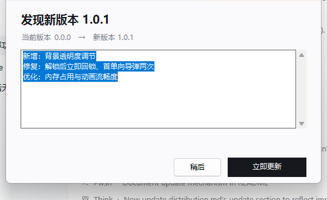
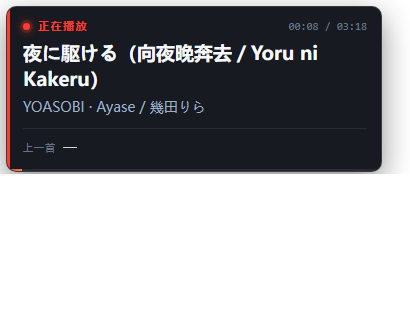

# Music Toppin

在游戏 / 直播画面上，用「击杀播报」的方式显示**系统正在播放的音乐**。

不需要登录账号，也不需要配置播放器：装上就自动读当前在放什么。V1 只做「显示」，点歌队列与点歌功能留到 V2。


## 数据来源：两条通道

| 通道 | 覆盖 | 拿到什么 | 控制 |
|---|---|---|---|
| **① SMTC**（系统「正在播放」） | Edge / Chrome（网页音乐、B 站视频）、Spotify、**Apple Music**、Windows 媒体播放器、部分播放器 | 曲目、歌手、**进度/时长**、播放状态 | 原生上一首 |
| **② 窗口标题 + 按进程音频会话** | **网易云音乐**、QQ音乐、酷狗、酷我、咪咕、iTunes、PotPlayer、foobar2000、AIMP、MusicBee、TTPlayer、MPC 等 | 曲目、歌手（**没有进度**）、播放/暂停 | 媒体键上一首 |

选源带**滞回**：已激活的源只要还在就保持，只有在它消失、或另一个源真的在播放且连续两拍确认后才切换。避免浏览器里留着一个暂停的视频时，把正在放歌的网易云顶掉、来回抖动。

### 关于 Apple Music（已实测）

本机实测版本 `1.1792.39942.0`，走通道 ①：

- ✅ 曲目、歌手、播放/暂停状态正常
- ✅ 会自动去掉它塞进歌手字段的专辑后缀（`Dua Lipa — Training Season - Single` → `Dua Lipa`）
- ⚠️ **没有进度条**：Apple Music 的 SMTC 把 `StartTime/Position/EndTime` 全报成 0，拿不到时长，卡片会自动隐藏进度条
- ⚠️ 它的窗口标题恒为 `Apple Music`，所以通道 ② 兜底对它无效，只能依赖 SMTC

### 关于网易云

网易云 3.x 默认**不注册 SMTC**（本机 3.1.43 的会话数是 0），所以走通道 ②：读窗口标题拿到「歌名 - 歌手」，用**该进程的音频会话状态**判断是否在出声（不是全局音量峰值，游戏音效不会让它误判成"正在播放"）。躲到托盘、窗口不可见且没在出声时，卡片会自动收起来。

### 为什么没有「下一首」

Windows 的 SMTC 只暴露**当前**媒体项，协议里没有队列；第三方播放器的播放列表在自己进程内存里。所以 V1 只显示「上一首」（自己的历史记录），「下一首」要等 V2 接入自己的点歌队列。

## 已实现

- 主卡片：**完整歌名**、**完整歌手**（都自动换行）、**上一首**、播放进度
- 下方灰卡：**「播放完毕」+「更早播放」各一张**，宽度依次缩小、透明度递减；切歌时整体下移、最旧一张淡出（200ms 堆叠动画）
- 暂停时红点转灰、显示「已暂停」
- 自定义颜色：主题色（红点 / 「正在播放」/ 进度条 / 左侧竖条 / 编辑态描边）、歌名、歌手；5 套一键预设
- 背景透明度：100%~40% 预设 + 滑块自定义，只影响背景不影响文字
- 位置：左上 / 右上 / 左下 / 右下 / 居中 + 自由拖动，记住锚点（尺寸变化自动重新贴边，支持负坐标的副屏）
- 打游戏不吞鼠标：默认鼠标穿透；`快捷键`解锁编辑态，12 秒无操作自动回锁
- 首次启动的上屏向导（按开播软件给 3 步）
- 托盘：显示/隐藏、锁定、绿幕、样式、播放控制、开机自启、退出
- 单实例、PerMonitorV2 DPI、无播放时自动隐藏


## 弹幕点歌（V2 · S2 已接入）

托盘右键 →「弹幕点歌」→「连接直播间…」，填房间号（`5050`，或直接粘贴 `https://live.bilibili.com/5050`）。连上后观众在直播间发：

| 弹幕 | 行为 |
|---|---|
| `点歌 BV1GJ411x7h7` | 解析 B 站视频的 DASH 音频，入队并自动播放 |
| `点歌 b23.tv/xxxx` | 先展开短链，再按 BV 处理 |
| `点歌 起风了`、`点歌 wy 起风了` | 入队，但**暂时放不了**——网易云/QQ/Apple Music 取流是 S3 |

- 队列：同曲 5 分钟内不重复、同一人 30 秒冷却、最多 20 首、先点先放；托盘菜单实时显示「队列：下一首（还有 N 首）」
- 第一首自动开播，放完自动下一首；放不了的会提示并跳过，不会卡住
- 断线自动重连（2 秒起翻倍，最长 30 秒）；菜单里能看到「直播间 xxx · 弹幕 N 条 · 队列 N 首」
- 直播间号会记住，下次启动自动重连；「断开直播间」会关掉自动重连
- 弹幕走**游客身份**，不用登录 B 站账号

> 只认「点歌」开头的弹幕（`点歌姬` 这类词不会误判）。协议细节与排错见 [docs/v2-danmaku.md](docs/v2-danmaku.md)。

## 安装

双击 `MusicToppin-Setup.exe`：

- **安装位置可以自己改**（默认 `%LocalAppData%\Programs\MusicToppin`，点「浏览…」或直接改路径，比如 `D:\MusicToppin`）
- 选到 `Program Files` 这类受保护目录时，会提示以管理员身份重新运行
- 卸载：Windows「设置 → 应用」里的 `Music Toppin`，或安装目录下的 `Uninstall.exe`（装在受保护目录时同样会自动提权）


命令行（适合批量部署）：

```
MusicToppin-Setup.exe /S /DIR="D:\Apps\MusicToppin"   静默安装到指定目录
MusicToppin-Setup.exe /S                              静默安装到默认目录
Uninstall.exe /S                                      静默卸载
```

> 升级时会沿用上次的安装位置，不会偷偷装回 C 盘。
## 让直播观众看到（OBS / 直播姬 / 直播伴侣）

### A. 透明直接采集（OBS 系，画质最好）

1. 托盘右键 →「绿幕模式」保持关闭
2. OBS 添加「窗口采集」→ 选中 `Music Toppin`
3. 采集方式选 **Windows 10 (1903 and up)**，勾选 **允许透明度**

### B. 绿幕抠像（直播姬 / 抖音直播伴侣 / 不支持透明采集的软件）


1. 托盘右键 → 勾选「绿幕模式」→ 浮窗变成绿底 + 卡片，四周留 12px 纯绿边
2. 直播软件里添加「窗口捕获」→ 选 `Music Toppin`
3. 给该源加「绿幕抠图 / 色度键」：抠色 `#00FF00`；OBS 参考参数：相似度 400、平滑 80、键色溢出 100

> 绿幕模式下卡片固定不透明（透明卡片会把绿底透上来，抠像时连卡片一起被抠掉）。

## 打游戏会不会被浮窗吞鼠标？

**默认不会。** 浮窗默认「锁定」= `WS_EX_TRANSPARENT` 鼠标穿透，准星扫过、在浮窗上开枪，点击都直接落到游戏里。

| 操作 | 方式 |
|---|---|
| 解锁 / 回锁 | 全局快捷键（启动时自动挑一个没被占用的组合，实际生效的显示在托盘菜单第一行；首选 `Alt+Shift+M`） |
| 解锁态的样子 | 卡片描边变红、标签变成「编辑中」 |
| 自动回锁 | 解锁后 12 秒没有鼠标操作自动锁回 |
| 兜底 | 托盘菜单里的「锁定浮窗（鼠标穿透）」开关 |

> 穿透只影响鼠标，不影响直播软件的窗口采集。
> 踩过的坑：`TopMost` 变化会触发 `UpdateStyles()`，把单独用 `SetWindowLong` 设的穿透位冲掉。所以穿透位写进 `CreateParams`，切换状态只调 `SetWindowLong`，不触发样式重建（否则会闪一帧）。

## 更新机制

启动 3.2 秒后自动检查（可在注册表 `UpdateCheckOnStart` 关掉），也可以从托盘「检查更新…」手动触发。

发布方只需要挂一个静态 JSON：

```json
{ "version": "1.0.1", "url": "https://…/MusicToppin-Setup.exe", "sha256": "…", "notes": "更新说明" }
```

- 也直接支持 GitHub Releases API（自动读 `tag_name` + `browser_download_url` + `body`）
- 地址可以写死在 `Updater.DefaultManifestUrl`（发布版内置，用户无需配置），也可以写在注册表 `HKCU\Software\MusicToppin\UpdateUrl` 方便测试
- 下载后用 SHA256 校验（清单没给就跳过），校验失败会丢弃并提示
- 确认更新后：写一个延迟批处理 → 等本进程退出 → `Setup.exe /S` 静默覆盖安装 → 重新拉起主程序


## 直播叠加层（OBS 浏览器源）

想让**自己打游戏时看不到卡片、但观众能看到**，用这个：

1. 托盘右键 → **「直播叠加层（OBS 浏览器源）」**（地址会自动复制到剪贴板）
2. OBS → 来源 → `+` → **浏览器** → 粘贴 `http://127.0.0.1:4681/`
3. 宽 **400**、高 **320**，勾选「关闭源时关闭页面」；背景是透明的，直接叠在画面上
4. 然后托盘里把 **「显示悬浮窗」** 关掉——桌面干净了，观众端照常显示



说明：

- 叠加层和桌面浮窗是两套独立输出，颜色、透明度、进度、上一首都跟桌面保持一致
- 地址端口从 `4681` 开始自动找空闲的，可用 `http://127.0.0.1:4681/` 直接在浏览器里预览
- 直播姬 / 直播伴侣如果支持「浏览器源」也能用；只有窗口采集的软件请继续用桌面浮窗
- 设置会记住，下次启动自动开启

### 只能用窗口采集的软件（直播姬 / 直播伴侣）

托盘右键 → **「离屏采集（窗口采集用）」**：浮窗会被移到所有显示器之外，

- 主播屏幕上看不到任何东西
- 窗口仍然存在且可见，采集软件里选窗口 **`Music Toppin`** 即可
- 想恢复：再点一次这个菜单，或者随便选一个「位置」预设

### 遮挡模式（第三种）

托盘右键 → **「遮挡模式（压在其他窗口后面）」**：浮窗取消置顶并被压到 Z 序最底。

- 全屏 / 无边框游戏会把它完全盖住，主播看不到
- 窗口仍在屏幕内，**只能抓屏幕内窗口的采集软件**也能拿到画面
- 切回桌面、没有窗口遮挡时会露出来——这时换「离屏采集」更合适

三种模式互斥，点一个会自动关掉另一个。

两种模式的区别：

| | 直播叠加层（浏览器源） | 离屏采集（窗口采集） | 遮挡模式（压后面） |
|---|---|---|---|
| 适用 | OBS、支持浏览器源的软件 | 直播姬等窗口采集，且能抓离屏窗口 | 窗口采集只能抓「屏幕内」窗口的软件 |
| 主播看到 | 没有（浮窗可关） | 没有（窗口在屏幕外） | 没有（被游戏/浏览器盖住） |
| 注意 | 需要浏览器源 | 采集端必须支持离屏窗口 | 切回桌面时可能露出来 |
## 低占用

| 项目 | 实测（本机 Win11，V2 构建，纯显示模式） |
|---|---|
| 安装包 | **361 KB** |
| 主程序 | **153 KB**（.NET Framework 4.8，系统自带运行时） |
| 内存（私有） | **25–33 MB**（点歌播放时才加载 WebView2，约 +160 MB） |
| 内存（含共享） | 56 MB |
| CPU | 空闲 **≈0 %**（2 秒轮询；点歌播放时由 WebView2 占用） |
| GPU | 0（纯 GDI+ 绘制，不用 WPF；点歌播放才加载 WebView2） |

关键优化：分批轮询（SMTC 在放歌时跳过窗口枚举）、窗口扫描 2 秒缓存、音频会话查询 2 秒缓存 + COM 对象显式释放、只在内容变化时重绘。

## 仓库

- 源码：https://github.com/EonloveL/D-music_toppin
- 计划：[V2 点歌姬架构评估](docs/v2-architecture.md)（含 BV 点播的可行性与方案对比）
- 发布：GitHub Releases（内置更新器默认指向本仓库的 `releases/latest`）

首次克隆后直接跑 `build.ps1` 即可：脚本会自动下载 Roslyn 编译器与 .NET Framework 引用程序集（约 45 MB，仅首次）。
## 从源码构建

不需要 .NET SDK，工具链缓存在 `.cache\nuget`。

```powershell
powershell -NoProfile -ExecutionPolicy Bypass -File .\build.ps1
```

产物：

```
build\app\MusicToppin.exe        153 KB
build\app\Uninstall.exe          15 KB
build\MusicToppin-Setup.exe      361 KB
```

构建链路：`toolchain.ps1` 定位 Roslyn `csc`（`Microsoft.Net.Compilers.Toolset`）、.NET Framework 4.8 引用程序集、WinRT 元数据（`Microsoft.Windows.SDK.Contracts`）→ 编译主程序（引用 `Windows.Media.winmd` 调 SMTC）→ 编译卸载器 → 打包 payload → 嵌入安装器。

## 目录

```
src/MusicToppin/
  Program.cs            入口、单实例
  TrayApp.cs            托盘、菜单、主题、位置、热键、向导调度
  NowPlayingService.cs  双通道协调（滞回选源、历史、看门狗）
  SmtcReader.cs         通道①：SMTC 读取与切歌
  WindowPlayers.cs      通道②：窗口标题解析（20+ 播放器）+ 媒体键
  AudioSessions.cs      按进程查音频会话状态（Core Audio）
  AudioPeak.cs          默认设备峰值（兜底）
  HudForm.cs            分层窗口、预乘 alpha、拖拽/穿透、动画
  HudRenderer.cs        GDI+ 绘制（主卡 / 灰卡堆叠 / 文字换行 / 进度条）
  HudTheme.cs           配色与透明度
  WizardForm.cs         首次启动上屏向导
  OpacityDialog.cs      背景透明度滑块
  Settings.cs           设置存 HKCU + 开机自启
  TrackHistory.cs       曲目历史（注册表）
  NowPlaying.cs         状态结构
  Logger.cs             日志（%TEMP%\musictoppin.log）
  SongRequest.cs        点歌指令解析（V2 S1）
  RequestQueue.cs       点歌队列：去重/冷却/上限/顶歌/撤回（V2 S1）
  Danmaku.cs            B 站直播弹幕客户端 + 弹幕协议（V2 S2）
  Json.cs               零依赖只读 JSON 解析
  Bilibili.cs           B 站取流：BV → view / playurl → DASH 音频
  WebView2Player.cs     隐藏 WebView2 音频宿主（Referer 注入、状态轮询）
  PromptDialog.cs       单行输入框
tests/                  单元测试（79 项：解析/队列/协议/JSON）
installer/
  Installer.cs          安装器（静默模式 / 安装中禁止关窗）
  Uninstall.cs          卸载器
build.ps1               一键构建
run-tests.ps1           一键跑单元测试
toolchain.ps1           编译器与引用程序集定位
docs/code-review-v1.md  V1 三轮独立评审与修复记录
docs/v2-danmaku.md      B 站弹幕协议笔记（S2）
```

## 命令行

```
MusicToppin.exe --demo                        演示数据
MusicToppin.exe --demo-fast                   演示数据，12 秒切一首
MusicToppin.exe --play-bv=BV1xx411c7mD        启动即播放指定 BV
MusicToppin.exe --room=5050                   启动即连接直播间弹幕
MusicToppin.exe --fake-danmaku="点歌 BV…"     注入一条假弹幕（自动化验证用）
MusicToppin-Setup.exe /S                      静默安装（成功返回 0）
Uninstall.exe /S                              静默卸载
```

## 已知限制

- 只支持 Windows（SMTC 是 Windows 专有）
- 窗口通道拿不到进度/时长，「下一首」未知（V2 随点歌队列补）
- Apple Music 的 SMTC 不报时长，所以没有进度条
- 播放判断依赖该进程的音频会话；输出到独占模式/WASAPI exclusive 时可能查不到状态，会退回端点峰值
- 播放器窗口标题格式被改过（foobar2000 自定义 title format）时可能解析错，可在 `WindowPlayers.cs` 按进程调整
- 独占全屏游戏会盖住任何置顶窗口 → 用无边框窗口化
- 弹幕点歌目前只支持 **B 站 BV**；网易云/QQ/Apple Music 只入队、真正播放要等 S3
- 弹幕压缩只解 zlib（鉴权时请求 `protover=2`）；B 站以后若强制 brotli，会提示并继续重试
- 弹幕走游客身份，只能拿到 uid / 昵称，拿不到完整用户资料；房间号必须是**开播中或有人说话**的直播间（冷场房间连上也收不到弹幕）

## V2 进度

- ✅ **S1 队列核心**：`点歌 / 點歌`、`wy/qq/am` 前缀、`id:`、`BV 号`、`b23.tv` 短链；去重/冷却/上限/顶歌/撤回
- ✅ **S2 弹幕接入**：直播间握手 → 游客鉴权 → 30 秒心跳 → zlib 解包 → `DANMU_MSG` 解析 → 入队 → 自动播放；断线自动重连；托盘可连接/断开/看队列
- ✅ **S4 播放链路验证**：托盘「点歌测试（播放 BV）…」输入 BV 号 → 解析 DASH 音频 → WebView2 播放 → HUD 显示真实标题与进度
- ⏳ S3 多平台取流、S5 展示整合（HUD 下一首/队列预览）

`tests/` 里 **79 项单元测试**覆盖解析、队列、弹幕协议、JSON；`run-tests.ps1` 一键跑（0 = 全过）。

**接手 V2 请先读 [docs/v2-handoff.md](docs/v2-handoff.md)**（现状、文件地图、待办、已知坑、调试入口）。

播放依赖 **WebView2 Runtime**（Windows 11 自带；Windows 10 一般随 Edge 安装）。不用点歌功能时不会加载它，纯显示模式仍是 153 KB / 25 MB 的轻量形态。
## 下一步（V2）

- S3：网易云 / QQ / Apple Music 取流，每个源一个 resolver，失败只影响单源
- S5：HUD 增加「下一首 / 队列预览」（点歌人、排队数），点歌板上屏
- 歌词行（滚动/逐字）、样式编辑器（字号/宽度/圆角）
