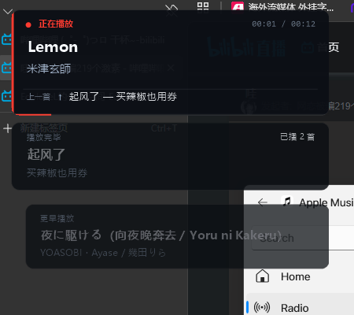
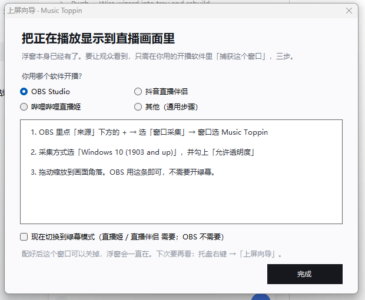
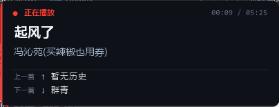
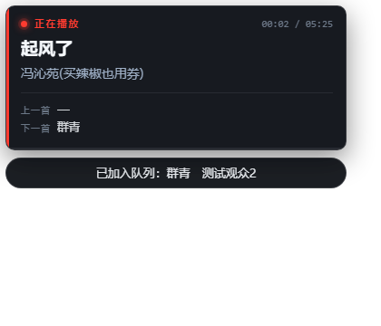
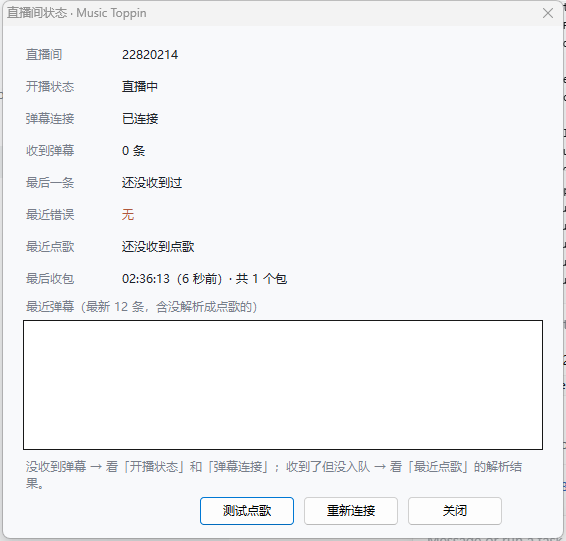
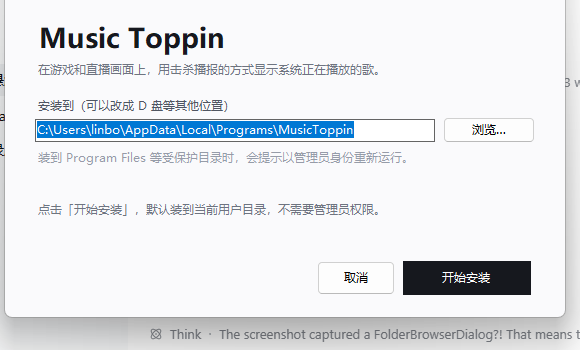
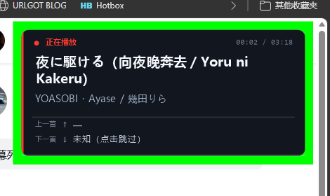

# Music Toppin

在游戏 / 直播画面上，用「击杀播报」的方式显示**系统正在播放的音乐**。

纯显示模式不需要登录账号，也不需要配置播放器：装上就自动读当前在放什么。**V2 已加入 B 站弹幕点歌**；点歌按平台登录情况取流，登录是可选的，只影响能放哪些歌。当前版本 **1.5.4**。



## 数据来源：两条通道

| 通道 | 覆盖 | 拿到什么 | 控制 |
|---|---|---|---|
| **① SMTC**（系统「正在播放」） | Edge / Chrome（网页音乐、B 站视频）、Spotify、**Apple Music**、Windows 媒体播放器、部分播放器 | 曲目、歌手、**进度/时长**、播放状态 | 原生上一首 |
| **② 窗口标题 + 按进程音频会话** | **网易云音乐**、QQ音乐、酷狗、酷我、咪咕、iTunes、PotPlayer、foobar2000、AIMP、MusicBee、TTPlayer、MPC 等 | 曲目、歌手（**没有进度**）、播放/暂停 | 媒体键上一首 |

选源带**滞回**：已激活的源只要还在就保持，只有在它消失、或另一个源真的在播放且连续两拍确认后才切换。避免浏览器里留着一个暂停的视频时，把正在放歌的网易云顶掉、来回抖动。

### 关于 Apple Music（已实测）

本机实测版本 `1.1792.39942.0`，走通道 ①：

- ✅ 曲目、歌手、播放/暂停状态正常
- ✅ 会自动去掉它塞进歌手字段的专辑后缀（`Dua Lipa — Training Season - Single` → `Dua Lipa`）
- ⚠️ **没有进度条**：Apple Music 的 SMTC 把 `StartTime/Position/EndTime` 全报成 0，拿不到时长，卡片会自动隐藏进度条
- ⚠️ 它的窗口标题恒为 `Apple Music`，所以通道 ② 兜底对它无效，只能依赖 SMTC

### 关于网易云

网易云 3.x 默认**不注册 SMTC**（本机 3.1.43 的会话数是 0），所以走通道 ②：读窗口标题拿到「歌名 - 歌手」，用**该进程的音频会话状态**判断是否在出声（不是全局音量峰值，游戏音效不会让它误判成"正在播放"）。躲到托盘、窗口不可见且没在出声时，卡片会自动收起来。

### 上一首 / 下一首

- **外部播放器**：Windows 的 SMTC 只暴露当前媒体项，没有队列；本应用通过系统 SMTC / 媒体键切歌，具体是「上一首」还是「重播当前」由播放器自己决定。
- **本应用播放**：点歌队列和默认歌单有自己的队列/历史，HUD 和环状样式能显示真实的「上一首 / 下一首」；托盘「上一首」会回退到本次运行内本应用实际播放过的歌曲（最多 12 首，重启清空）。
- 本应用播放时，HUD/环状使用本次运行的会话历史；外部播放器使用持久化最近 3 首（单曲播放 ≥15 秒才计入，跨重启保留），仅用于显示。

## 已实现

- 主卡片：**完整歌名**、**完整歌手**（都自动换行）、**上一首**、播放进度
- 下方灰卡（击杀播报样式）：**「播放完毕」+「更早播放」各一张**，宽度依次缩小、透明度递减；切歌时整体下移、最旧一张淡出（200ms 堆叠动画）
- **环状毛玻璃样式**：可放在屏幕上/下/左/右，圆心在屏幕外，上一首/下一首分列两侧；正向切歌时旧上一首在原槽位淡出、当前/下一首滚入，本应用内回退到上一首（有历史）时反向滚动（二次缓出）。当前播放文字不发光、保持锐利；上一首/下一首带很轻的同色光晕并降低透明度，文字保持可读（绿幕模式跳过淡出残影）
- **上一首 / 重播当前**：托盘「播放控制 → 上一首」会回退到本应用刚播过的歌曲（点歌 / 默认歌单 / 手动 BV）；历史只保留本次运行内最多 12 首，重启清空。没有历史时才重头播当前；「重播当前」只把当前曲目回到开头。外部播放器仍通过系统 SMTC / 媒体键切歌。
- **贴边镜像**：击杀播报样式贴左侧时灰卡向左对齐、强调条换到右侧，切歌时灰卡向左展开；极简样式只切换强调条位置；贴右侧保持原来的右对齐与纵向堆叠动画
- **守望先锋模式（显示歌词）**：样式菜单选择后主叠层 `/` 显示底部圆圈 + 左右卡片 + 歌词；主题在「样式 → 主题」切换：无装饰 / 暹罗猫 / 腊肠狗 / 德文猫三种宠物 + 春节 / 圣诞 / 万圣 / 中秋 / 情人五种节日（emoji 装饰 + 节日配色）。该样式只在浏览器源渲染（OBS 浏览器源宽 1920 高 1080），桌面浮窗会自动隐藏；OBS 仍只需 `/` 和 `/video` 两个浏览器源
- 暂停时红点转灰、显示「已暂停」
- 自定义颜色：主题色（红点 / 「正在播放」/ 进度条 / 强调竖条（贴左时在右）/ 编辑态描边）、歌名、歌手；5 套一键预设
- 背景透明度：100%~40% 预设 + 滑块自定义，只影响背景不影响文字
- 位置：左上 / 右上 / 左下 / 右下 / 左侧 / 右侧 / 居中 + 自由拖动，记住锚点（尺寸变化自动重新贴边，支持负坐标的副屏）
- 打游戏不吞鼠标：默认鼠标穿透；`快捷键`解锁编辑态，12 秒无操作自动回锁
- 上屏向导：选开播软件后一键应用推荐配置（OBS 浏览器源 / 窗口采集 / 绿幕 / 离屏），内置弹幕点歌、权限、完整功能说明和常见问题
- 托盘：显示/隐藏、锁定、绿幕、样式、播放控制、开机自启、退出
- 单实例、PerMonitorV2 DPI、无播放时自动隐藏



## 弹幕点歌（V2 · S2 已接入）

托盘右键 →「弹幕点歌」→「连接直播间…」，填房间号（`5050`，或直接粘贴 `https://live.bilibili.com/5050`）。连上后观众在直播间发：

| 弹幕 | 行为 |
|---|---|
| `点歌 BV1GJ411x7h7` | 解析 B 站视频的 DASH 音频，入队并自动播放 |
| `点歌 b23.tv/xxxx` / `点歌 https://b23.tv/xxxx` | 先展开短链，再按 BV 处理（不带 https:// 也认） |
| `点歌 https://www.bilibili.com/video/BV…` | 完整 B 站视频链接也能识别 |
| `点歌 起风了`、`点歌 wy 起风了` | 网易云搜索 → 320k 直链，入队并播放 |
| `点歌 id:1330348068` | 直接按网易云歌曲 ID 取流 |
| `点歌 qq 夜に駆ける` | QQ 音乐搜索 → vkey 取流，入队并播放 |
| `qq I don't care Ed Sheeran` | 平台前缀直接开头（不带「点歌」）也能点歌 |
| `点歌 am Lemon` | 入队，但暂时放不了（Apple Music 网页端只有 30 秒试听，没接） |
| `切歌` | 切掉当前这首（默认所有人可切，可改成仅点歌人或关闭） |
| `撤回` / `撤回 2` / `撤回 起风了` | 撤掉自己点的待播歌 / 队列第 2 首 / 按歌名唯一匹配的待播歌（正在播的不能撤，用「切歌」） |

### 点歌走哪个平台

- **不写前缀**（`点歌 起风了`）：按登录情况自动选 —— **只登录了一个平台就用它**；都登录了网易云优先、QQ 兜底
- **两种写法都认**：`点歌 qq 歌名` 和 `qq 歌名`（平台前缀直接开头，可不带「点歌」）
- 容错：`点歌：起风了`、`点歌，起风了`、`点歌qq 起风了`（少空格）都能识别

| 已登录 | `点歌 歌名` | `wy 歌名` | `qq 歌名` |
|---|---|---|---|
| 仅网易云 | 网易云 | 网易云 | QQ（QQ 未登录时多数歌放不了） |
| 仅 QQ 音乐 | **QQ 音乐**（客户端登录也算；取不到流时兜底网易云） | 网易云（游客曲库） | QQ 音乐 |
| 两个都登录 | **网易云优先**，失败兜底 QQ | 网易云 | QQ 音乐 |
- **写前缀**：`点歌 wy …` / `点歌 qq …` 强制指定平台；`点歌 BV…` 走 B 站视频
- 酷狗按需求先移除（后续要加时再看 [docs/v2-sources.md](docs/v2-sources.md)）

### 曲源登录（开箱即用）

> 播放始终在**应用内**完成（隐藏的 WebView2 音频宿主）：客户端登录只决定「能取到哪些歌」，点歌不会被交给外部播放器。

托盘右键 →「**曲源（登录）**」：

- **网易云：从官方客户端同步登录（推荐）** —— 只要本机装了网易云客户端并登录过，应用会自动读出登录会话（会话只保存在本机；播放取流时会按平台要求随请求发往网易云），会员曲也能按你账号的权限放。启动时如果还没登录，会自动尝试一次。
- **网易云：登录（扫码 / 手机号）…** —— 没装客户端时的备选，应用内打开官方登录页，扫码后自动保存。
- **QQ 音乐：登录（QQ / 微信扫码）…** —— QQ 音乐未登录时大部分歌只给空地址；登录后正常。
- **播放器检查…** —— 列出网易云 / QQ 音乐的「已安装 / 运行中 / 登录」状态：网易云读客户端会话，QQ 音乐读内嵌 chromium 的 cookie（`pt2gguin`，兼容 `qmcomdata.ini`）；没开客户端时可以直接点「启动」，状态不对可以点「再次检查」。

> 各平台取流接口、登录方式和候选平台（酷狗、汽水、YouTube、Spotify）的可行性见 [docs/v2-sources.md](docs/v2-sources.md)。

**隐私与联网**：应用不注入游戏/不读游戏内存、不需要管理员权限；会读取本机媒体元信息（SMTC / 窗口标题 / 音频会话）用于显示与切歌；登录会话只保存在本机并加密，仅在你使用对应平台取流时随请求发往该平台；默认歌单、点歌、视频小窗会访问网易云 / QQ 音乐 / B 站接口。除此之外不上传个人数据，也不含任何音乐内容。

- 队列：同曲 5 分钟内不重复、同一人 30 秒冷却、最多 20 首、先点先放
- **默认播放歌单（网易云 / QQ 音乐二选一）**：托盘「默认歌单」→ 设置歌单链接或 ID。默认歌单持续播放；新点歌排在当前曲目之后，点歌队列空了自动继续默认歌单的下一首。只持久化平台 ID/名称；启用时把歌单元信息读入内存，播放时逐首取直链。
- **点歌权限**（默认「粉丝团灯牌或舰长」，可随时切回所有人）：托盘「弹幕权限」或「弹幕点歌 → 点歌权限」切换 所有人 / **粉丝团灯牌或舰长** / 仅舰长（大航海）/ 关闭。粉丝团灯牌要求是**本直播间**的牌子；舰长、提督、总督都算大航海。
- **切歌权限**（默认「仅点歌人」，房管可切全部）：所有人 / **仅点歌人（房管可切全部）** / 仅房管 / 关闭。普通观众只能切自己点的那首；带房管标识的观众始终可以切全部。
- **撤回权限**（默认仅本人，房管可撤全部）：所有人 / 仅本人 / 关闭；正在播的那首只能「切歌」，不能撤回。
- **同一时间只放一首**：新歌排在当前之后；手动「点歌测试」会先停掉队列播放，不会两路同时出声
- **点歌音量**：托盘「播放控制 → 点歌音量」可选 100/80/60/50/40/20/静音 + 自定义滑块，默认 **60%**，拖动即时生效并记住（不会动系统音量）
- **反作弊保守模式**：托盘「播放控制 → 反作弊保守模式」可禁用媒体键切歌，避免向系统注入上一首/下一首按键；不影响点歌与默认歌单
- **视频声音**：默认「走应用播放器」，确保 OBS 里一定有声音（用上面的音量滑块）；OBS 允许带声自动播放时可切「跟随视频」获得音画同源
- **弹幕切歌 / 撤回**：观众发「切歌」切当前；「撤回」「撤回 2」「撤回 歌名」删待播；撤回还有 2 秒防刷
- 托盘「点歌队列（N 首）」可以展开看前 10 首（序号 · 歌名 · 点歌人），里面还有「下一首 / 清空队列」
- 第一首自动开播，放完自动下一首；放不了的会提示并跳过，不会卡住
- HUD 多显示一行「下一首 ↓」，带队列长度；队列空了这行会自动收起（点歌模式才有）
- 观众端：叠加层同样显示「下一首」，点歌成功 / 放不了会在叠加层底部弹 4.5 秒提示（不影响主播画面）




- 断线自动重连（2 秒起翻倍，最长 30 秒）；菜单里能看到「直播间 xxx · 弹幕 N 条 · 队列 N 首」
- 弹幕链路：`getDanmuInfo`（wbi 签名 + 2245 端口）优先、旧 `getConf` 兜底；zlib / brotli 两种压缩都支持，登录后 token 与 uid 自动匹配
- 直播间号会记住，下次启动自动重连；「断开直播间」会关掉自动重连
- **「B 站：登录（扫码，弹幕用）…」**：部分直播间只给登录用户下发弹幕；登录后弹幕连接会带账号（游客只收到人气包）
- **「直播间状态…」**：看开播状态 / 是否连上弹幕 / 收到多少条 / 最后一条时间 / 最近错误 / **最近 12 条弹幕原文** / **最近一次点歌解析结果**；未开播会明确标出来（未开播时 B 站不推弹幕），可一键「重新连接」，还有「测试点歌」用来单独验证播放链路


- 弹幕默认走**游客身份**；部分房间只给登录用户下发弹幕，可在「弹幕点歌 → B 站：登录（扫码，弹幕用）」登录
- **默认不弹通知**：点歌/连接/播放状态只写日志和托盘「弹幕点歌」菜单里的状态行，不会在右下角弹窗（直播时弹窗会干扰键鼠输入判定）；想要气泡提示可在菜单底部打开「点歌/播放时弹气泡提示」

### 视频点播（直播画面里的小窗）

点的是 B 站视频时（`点歌 BV…`），视频会出现在叠加层的 `/video` 页面 —— **只在直播画面里**，主播自己的桌面看不到：

1. OBS 里再加一个「浏览器源」，地址是叠加层地址加 `/video`（托盘「复制视频小窗地址」一键复制），建议 **480×270**，摆在画面角落
2. 两个源**共用一个端口**（同一个本地服务），端口被占用会自动换并记住；托盘菜单里可以分别「复制叠加层地址 / 复制视频小窗地址」
3. 默认**声音走应用播放器**（和音乐同一个音量滑块），保证 OBS 里有声；如果确认 OBS 允许带声自动播放，可在「播放控制 → 视频声音」切「跟随视频」获得音画同源
4. 视频放完 / 下一首是音乐时，小窗自动消失
5. 小窗会按视频真实宽高比自适应（竖屏 / 4:3 / 超宽都行），周围留白保持透明，不会出现 letterbox 黑边
6. 可在「播放控制 → 视频点播」关闭 BV 点播；关闭后 BV 点歌和手动 BV 都会被拒绝

> 部分 UP 主关闭了站外播放，这类视频小窗会回退到 B 站官方播放器（会带一点播放器 UI）；音频仍会正常播。

> 只认「点歌」开头的弹幕（`点歌姬` 这类词不会误判）。协议细节与排错见 [docs/v2-danmaku.md](docs/v2-danmaku.md)。

## 安装

双击 `MusicToppin-Setup.exe`：

- **安装位置可以自己改**（默认 `%LocalAppData%\Programs\MusicToppin`，点「浏览…」或直接改路径，比如 `D:\MusicToppin`）
- 选到 `Program Files` / `Windows` 这类系统目录会被拒绝；请装到用户目录或 `D:\MusicToppin` 等普通目录（其他无写权限目录会提示以管理员身份重新运行）
- 卸载：Windows「设置 → 应用」里的 `Music Toppin`，或安装目录下的 `Uninstall.exe`（无删除权限时会尝试提权）



命令行（适合批量部署）：

```
MusicToppin-Setup.exe /S /DIR="D:\Apps\MusicToppin"   静默安装到指定目录
MusicToppin-Setup.exe /S                              静默安装到默认目录
Uninstall.exe /S                                      静默卸载
```

> 升级时会沿用上次的安装位置，不会偷偷装回 C 盘。
## 让直播观众看到（OBS / 直播姬 / 直播伴侣）

### A. 透明直接采集（OBS 系，画质最好）

1. 托盘右键 →「绿幕模式」保持关闭
2. OBS 添加「窗口采集」→ 选中 `Music Toppin`
3. 采集方式选 **Windows 10 (1903 and up)**，勾选 **允许透明度**

### B. 绿幕抠像（直播姬 / 抖音直播伴侣 / 不支持透明采集的软件）



1. 托盘右键 → 勾选「绿幕模式」→ 浮窗变成绿底 + 卡片，四周留 12px 纯绿边
2. 直播软件里添加「窗口捕获」→ 选 `Music Toppin`
3. 给该源加「绿幕抠图 / 色度键」：抠色 `#00FF00`；OBS 参考参数：相似度 400、平滑 80、键色溢出 100

> 绿幕模式下卡片固定不透明（透明卡片会把绿底透上来，抠像时连卡片一起被抠掉）。

## 打游戏会不会被浮窗吞鼠标？

**默认不会。** 浮窗默认「锁定」= `WS_EX_TRANSPARENT` 鼠标穿透，准星扫过、在浮窗上开枪，点击都直接落到游戏里。

| 操作 | 方式 |
|---|---|
| 解锁 / 回锁 | 全局快捷键（启动时自动挑一个没被占用的组合，实际生效的显示在托盘菜单第一行；首选 `Alt+Shift+M`） |
| 解锁态的样子 | 卡片描边变红、标签变成「编辑中」 |
| 自动回锁 | 解锁后 12 秒没有鼠标操作自动锁回 |
| 兜底 | 托盘菜单里的「锁定浮窗（鼠标穿透）」开关 |

> 穿透只影响鼠标，不影响直播软件的窗口采集。
> 踩过的坑：`TopMost` 变化会触发 `UpdateStyles()`，把单独用 `SetWindowLong` 设的穿透位冲掉。所以穿透位写进 `CreateParams`，切换状态只调 `SetWindowLong`，不触发样式重建（否则会闪一帧）。

## 更新机制

启动 3.2 秒后自动检查（可在注册表 `UpdateCheckOnStart` 关掉），也可以从托盘「检查更新…」手动触发。

发布方只需要挂一个静态 JSON：

```json
{ "version": "1.5.4", "url": "https://…/MusicToppin-Setup.exe", "sha256": "…", "notes": "更新说明" }
```

- 也直接支持 GitHub Releases API（自动读 `tag_name` + `browser_download_url` + `body`）
- 地址可以写死在 `Updater.DefaultManifestUrl`（发布版内置，用户无需配置），也可以写在注册表 `HKCU\Software\MusicToppin\UpdateUrl` 方便测试
- 下载后必须校验 SHA256：清单没给校验值会拒绝自动安装；校验失败会丢弃并提示
- 确认更新后：写一个延迟批处理 → 等本进程退出 → `Setup.exe /S /DIR="当前安装目录"` 静默覆盖安装 → 重新拉起主程序；失败会保留旧版本并重新启动


## 直播叠加层（OBS 浏览器源）

想让**自己打游戏时看不到卡片、但观众能看到**，用这个：

1. 托盘右键 → **「直播叠加层（OBS 浏览器源）」**（地址会自动复制到剪贴板）
2. OBS → 来源 → `+` → **浏览器** → 粘贴 `http://127.0.0.1:4681/`
3. 宽 **400**、高 **320**，勾选「关闭源时关闭页面」；背景是透明的，直接叠在画面上
   - 样式选的是 **守望先锋模式（显示歌词）** 时改成宽 **1920**、高 **1080**（16:9 全画布），否则整个 HUD 会被缩得很小。圆圈默认按游戏 HUD 缩放 100% 对位；对不齐时用托盘「样式 → 守望先锋对位微调」上下移动 / 放大缩小（即时生效）
4. 然后托盘里把 **「显示悬浮窗」** 关掉——桌面干净了，观众端照常显示


说明：

- 叠加层和桌面浮窗是两套独立输出，颜色、透明度、进度、上一首都跟桌面保持一致
- 地址端口从 `4681` 开始自动找空闲的，可用 `http://127.0.0.1:4681/` 直接在浏览器里预览
- 直播姬 / 直播伴侣如果支持「浏览器源」也能用；只有窗口采集的软件请继续用桌面浮窗（守望先锋模式例外：该样式只走浏览器源，桌面浮窗会自动隐藏）
- 设置会记住，下次启动自动开启

### 只能用窗口采集的软件（直播姬 / 直播伴侣）

托盘右键 → **「离屏采集（窗口采集用）」**：浮窗会被移到所有显示器之外，

- 主播屏幕上看不到任何东西
- 窗口仍然存在且可见，采集软件里选窗口 **`Music Toppin`** 即可
- 想恢复：再点一次这个菜单，或者随便选一个「位置」预设

### 遮挡模式（第三种）

托盘右键 → **「遮挡模式（压在其他窗口后面）」**：浮窗取消置顶并被压到 Z 序最底。

- 全屏 / 无边框游戏会把它完全盖住，主播看不到
- 窗口仍在屏幕内，**只能抓屏幕内窗口的采集软件**也能拿到画面
- 切回桌面、没有窗口遮挡时会露出来——这时换「离屏采集」更合适

三种模式互斥，点一个会自动关掉另一个。

两种模式的区别：

| | 直播叠加层（浏览器源） | 离屏采集（窗口采集） | 遮挡模式（压后面） |
|---|---|---|---|
| 适用 | OBS、支持浏览器源的软件 | 直播姬等窗口采集，且能抓离屏窗口 | 窗口采集只能抓「屏幕内」窗口的软件 |
| 主播看到 | 没有（浮窗可关） | 没有（窗口在屏幕外） | 没有（被游戏/浏览器盖住） |
| 注意 | 需要浏览器源 | 采集端必须支持离屏窗口 | 切回桌面时可能露出来 |
## 低占用

| 项目 | 实测（本机 Win11，V2 构建，纯显示模式） |
|---|---|
| 安装包 | **约 1204 KB** |
| 主程序 | **约 431 KB**（.NET Framework 4.8，系统自带运行时） |
| 内存（私有） | **25–33 MB**（点歌播放时才加载 WebView2，约 +160 MB） |
| 内存（含共享） | 56 MB |
| CPU | 空闲 **≈0 %**（500ms 轮询 + 2 秒缓存；点歌播放时由 WebView2 占用） |
| GPU | 0（纯 GDI+ 绘制，不用 WPF；点歌播放才加载 WebView2） |

关键优化：分批轮询（SMTC 在放歌时跳过窗口枚举）、窗口扫描 2 秒缓存、音频会话查询 2 秒缓存 + COM 对象显式释放、只在内容变化时重绘。

## 仓库

- 源码：https://github.com/EonloveL/D-music_toppin
- 计划：[V2 点歌姬架构评估](docs/v2-architecture.md)（含 BV 点播的可行性与方案对比）
- 发布：GitHub Releases（内置更新器默认指向本仓库的 `releases/latest`）

首次克隆后直接跑 `build.ps1` 即可：脚本会自动下载 Roslyn 编译器与 .NET Framework 引用程序集（约 45 MB，仅首次）。
## 从源码构建

不需要 .NET SDK，工具链缓存在 `.cache\nuget`。

```powershell
powershell -NoProfile -ExecutionPolicy Bypass -File .\build.ps1
```

产物：

```
build\app\MusicToppin.exe        约 431 KB
build\app\Uninstall.exe          约 15 KB
build\MusicToppin-Setup.exe      约 1204 KB
```

构建链路：`toolchain.ps1` 定位 Roslyn `csc`（`Microsoft.Net.Compilers.Toolset`）、.NET Framework 4.8 引用程序集、WinRT 元数据（`Microsoft.Windows.SDK.Contracts`）→ 编译主程序（引用 `Windows.Media.winmd` 调 SMTC）→ 编译卸载器 → 打包 payload → 嵌入安装器。

## 目录

```
src/MusicToppin/
  Program.cs            入口、单实例
  TrayApp.cs            托盘、菜单、主题、位置、热键、向导调度
  NowPlayingService.cs  双通道协调（滞回选源、历史、看门狗）
  SmtcReader.cs         通道①：SMTC 读取与切歌
  WindowPlayers.cs      通道②：窗口标题解析（20+ 播放器）+ 媒体键
  AudioSessions.cs      按进程查音频会话状态（Core Audio）
  AudioPeak.cs          默认设备峰值（兜底）
  HudForm.cs            分层窗口、预乘 alpha、拖拽/穿透、动画、离屏/遮挡采集
  HudRenderer.cs        GDI+ 绘制（主卡 / 灰卡堆叠 / 文字换行 / 进度条）
  HudTheme.cs           配色与透明度
  OverlayServer.cs      直播叠加层：本地 HTTP + 透明 HTML（OBS 浏览器源）
  WizardForm.cs         上屏向导（一键上屏 + 弹幕点歌 / 权限 / 功能说明 / 常见问题）
  OpacityDialog.cs      背景透明度滑块
  Settings.cs           设置存 HKCU + 开机自启
  TrackHistory.cs       曲目历史（注册表）
  NowPlaying.cs         状态结构
  Logger.cs             日志（%TEMP%\musictoppin.log）
  SongRequest.cs        点歌指令解析（V2 S1）
  RequestQueue.cs       点歌队列：去重/冷却/上限/顶歌/撤回（V2 S1）
  Danmaku.cs            B 站直播弹幕客户端 + 弹幕协议（V2 S2）
  SongResolvers.cs      按来源分派取流器（加平台只加一个 case）
  Netease.cs            网易云取流：搜索 / id → player/url 320k → outer 兜底（V2 S3）
  NeteaseClient.cs      从官方客户端同步登录（DPAPI + AES-GCM 读 CEF cookie）
  QQMusic.cs            QQ 音乐取流：搜索 → vkey（需登录）（V2 S3）
  WebLoginForm.cs       应用内登录窗口（官方登录页 + 自动抓 cookie）
  SourceCheck.cs        播放器检查：已安装 / 运行中 / 登录（三平台各自的本地信号）
  PlayerCheckForm.cs    播放器检查对话框（再次检查 / 启动客户端）
  IniFile.cs            极简 ini 读取（QQ 音乐登录账号）
  Sqlite.cs             只读 SQLite（winsqlite3.dll，读客户端 cookie 库）
  ResolvedSong.cs       各平台统一的「可播放条目」
  Playlist.cs           默认歌单：平台歌单解析 / 逐首取流（网易云、QQ 音乐）
  Json.cs               零依赖只读 JSON 解析
  Bilibili.cs           B 站取流：BV → view / playurl → DASH 音频
  WebView2Player.cs     隐藏 WebView2 音频宿主（Referer 注入、状态轮询）
  PromptDialog.cs       单行输入框
tests/                  单元测试（217 项：解析/队列/协议/JSON/曲源/权限）
installer/
  Installer.cs          安装器（静默模式 / 安装中禁止关窗）
  Uninstall.cs          卸载器
build.ps1               一键构建
run-tests.ps1           一键跑单元测试
toolchain.ps1           编译器与引用程序集定位
docs/code-review-v1.md  V1 三轮独立评审与修复记录
docs/v2-danmaku.md      B 站弹幕协议笔记（S2）
docs/v2-sources.md      曲源与登录：接口、可行性与候选平台
```

## 命令行

```
MusicToppin.exe --demo                        演示数据
MusicToppin.exe --demo-fast                   演示数据，12 秒切一首
MusicToppin.exe --play-bv=BV1xx411c7mD        启动即播放指定 BV
MusicToppin.exe --room=5050                   启动即连接直播间弹幕
MusicToppin.exe --fake-danmaku="点歌 BV…"     注入假弹幕（可重复传多个，依次触发）
MusicToppin.exe --login-test=netease          打开网易云登录窗口（调试）
MusicToppin.exe --live-status                 打开「直播间状态」窗口（配合 --room 用）
MusicToppin-Setup.exe /S                      静默安装（成功返回 0）
Uninstall.exe /S                              静默卸载
```

## 已知限制

- 只支持 Windows（SMTC 是 Windows 专有）
- 窗口通道本身拿不到进度/时长与「下一首」；点歌播放时由队列补上下一首
- Apple Music 的 SMTC 不报时长，所以没有进度条
- 播放判断依赖该进程的音频会话；输出到独占模式/WASAPI exclusive 时可能查不到状态，会退回端点峰值
- 播放器窗口标题格式被改过（foobar2000 自定义 title format）时可能解析错，可在 `WindowPlayers.cs` 按进程调整
- 独占全屏游戏会盖住任何置顶窗口 → 用无边框窗口化
- 弹幕点歌目前支持 **网易云**（关键词 / `id:`）、**QQ 音乐**（`qq` 前缀）、**B 站 BV**；Apple Music 还没接
- 网易云 / QQ 音乐的**版权曲需要登录**：网易云可自动同步官方客户端登录；QQ 音乐要在「曲源（登录）」里扫码
- 网易云在两种身份下能放的歌不同：游客只有免费曲，会员曲靠登录后的账号权限；拿不到直链会提示并跳过，不会卡住
- 弹幕压缩 **zlib / brotli 都支持**；优先 `getDanmuInfo`（wbi + 2245），失败回退旧 `getConf`
- 弹幕默认走游客身份，只能拿到 uid / 昵称；部分房间要求登录，登录后可拿到完整弹幕。房间号必须是**开播中或有人说话**的直播间（冷场房间连上也收不到弹幕）
- 视频小窗是**本地代理的 MP4**（画面里没有 B 站播放器 UI / 登录提示 / 小程序信息）；版权限制或 UP 主关闭站外播放的视频可能取不到流（音频不受影响）
- **视频本地缓存**：边下边播，先缓冲 8MB 再起播；下载限速 3MB/s（避免抢游戏带宽），缓存放在 `%TEMP%\MusicToppin\video`，上限 2GB、2 天自动清理
- **点歌人显示**：当前歌曲是观众点歌时，HUD（经典/环状）和 OBS 叠加层会显示「点歌人：xxx」
- **歌词显示**：歌词集成在「守望先锋模式（显示歌词）」样式里，不再有独立歌词页面。托盘「样式 → 主题」可切 无装饰 / 暹罗猫 / 腊肠狗 / 德文猫 / 春节 / 圣诞 / 万圣 / 中秋 / 情人；宠物主题图放在安装目录 `assets/themes/`，节日主题用 emoji 装饰、不占体积。歌词只对本应用播放（点歌 / 默认歌单）生效，外部播放器不显示歌词
- 酷我经实测免费歌只有移动端能用（桌面只给 ~11 秒试听），已放弃接入
- 抖音直播间暂不支持：链接能识别但弹幕要签名 + protobuf，后续再接（现在只支持 B 站房间号 / 链接）
- B 站弹幕在部分房间要求**登录**（游客只收到人气包）；用「B 站：登录（扫码，弹幕用）」登录即可

## V2 进度

- ✅ **S1 队列核心**：`点歌 / 點歌`、`wy/qq/am` 前缀、`id:`、`BV 号`、`b23.tv` 短链；去重/冷却/上限/顶歌/撤回
- ✅ **S2 弹幕接入**：直播间握手 → 游客/登录鉴权 → 30 秒心跳 → zlib / brotli 解包 → `DANMU_MSG` 解析 → 入队 → 自动播放；断线自动重连；托盘可连接/断开/看队列
- ✅ **S3（网易云 + QQ 音乐）**：`点歌 起风了` / `点歌 wy …` / `点歌 id:…` → 网易云搜索 → 320k 直链 → 播放；`点歌 qq …` → QQ 音乐搜索 → vkey → 播放；无版权自动跳过；登录支持「同步官方客户端 / 应用内扫码」
- ✅ **S4 播放链路验证**：托盘「点歌测试（播放 BV）…」输入 BV 号 → 解析 DASH 音频 → WebView2 播放 → HUD 显示真实标题与进度
- ✅ **S5**：HUD 与叠加层都显示「下一首 + 队列长度」；托盘可展开队列列表；点歌成功/失败在叠加层弹提示
- ✅ **视频小窗**：B 站视频点播在直播画面里用小窗播放；默认声音走应用播放器，可在「视频声音」切「跟随视频」，主播桌面不出现
- ✅ **v1.3 权限与向导**：点歌权限（所有人 / 粉丝团灯牌或舰长 / 仅舰长 / 关闭）与切歌权限（所有人 / 仅点歌人且房管可切全部 / 仅房管 / 关闭）可随时在托盘「弹幕权限」切换；上屏向导重做为「一键上屏 + 弹幕点歌 + 权限 + 功能说明 + FAQ」
- ✅ **v1.4 环状毛玻璃**：托盘「样式 → 环状毛玻璃」，可放屏幕上/下/左/右；上一首/下一首分列两侧，切歌沿圆周滚动，文字带同色光晕和毛玻璃质感
- ✅ **v1.4 默认歌单**：托盘「默认歌单」导入网易云或 QQ 音乐歌单（二选一）；默认歌单持续播放，新点歌排在当前曲目之后，点歌队列空了自动继续
- ⏳ S3 剩余：Apple Music（只有试听）；酷狗按需求先移除

`tests/` 里 **217 项单元测试**覆盖解析、队列、弹幕协议、JSON、曲源、歌单和权限；`run-tests.ps1` 一键跑（0 = 全过）。

**接手 V2 请先读 [docs/v2-handoff.md](docs/v2-handoff.md)**（现状、文件地图、待办、已知坑、调试入口）。

> 弹幕「连上了但收不到」的完整复盘与排查方法：[docs/postmortem-danmaku.md](docs/postmortem-danmaku.md)

播放依赖 **WebView2 Runtime**（Windows 11 自带；Windows 10 一般随 Edge 安装）。不用点歌功能时不会加载它，纯显示模式仍是 **约 431 KB / 25–33 MB** 的轻量形态（弹幕 brotli 解码库约 +1.3 MB 只在安装包里）。
## 下一步（V2）

- S3 剩余：Apple Music（只有试听）；酷狗/酷我按需求先不做，见 [docs/v2-sources.md](docs/v2-sources.md)
- 歌词样式细化（逐字 / 滚动效果）、样式编辑器（字号/宽度/圆角）
