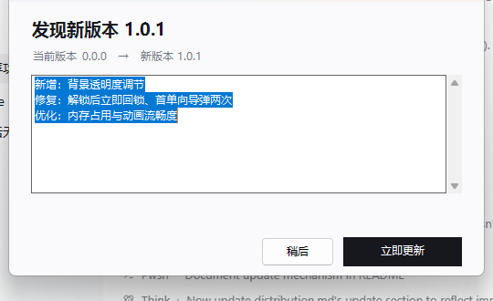

# 分发方案（V1）

面向的用户是「不熟 OBS、只想开播时挂个歌名」的主播。分发要解决三件事：**敢装（不报毒）**、**装得上（渠道通）**、**能升级（不用重新教一遍）**。

---

## 一、发布前必须做的四件事

### 1. 代码签名（最重要，决定"敢不敢装"）

未签名的 exe 会触发：

- Windows SmartScreen「Windows 已保护你的电脑 / 未知发布者」
- 360 / 电脑管家 直接拦截（本程序会枚举窗口、发送媒体键、读音频会话，行为特征容易被判可疑）

| 证书类型 | 价格（国内代理参考） | 效果 |
|---|---|---|
| OV（组织验证） | ¥1000–3000 / 年 | SmartScreen 需要累积下载量才转好，初期仍可能提示 |
| EV（扩展验证） | ¥3000–5000 / 年，需硬件 UKey | **立即**获得 SmartScreen 信誉，最省心 |

签名命令（签 setup 和 exe，**先签 exe 再打包**）：

```powershell
signtool sign /fd sha256 /tr http://timestamp.digicert.com /td sha256 /a build\app\MusicToppin.exe
# 先重新打包，再签安装器
signtool sign /fd sha256 /tr http://timestamp.digicert.com /td sha256 /a build\MusicToppin-Setup.exe
```

> 现状：`build.ps1` 里还没有签名步骤。买了证书后在 `[5/5]` 之后加一行 `signtool` 即可。

### 2. 版本号与更新日志

已补 `src/MusicToppin/VersionInfo.cs`（`AssemblyVersion 1.0.0.0`），安装器常量同步为 `1.0.0`。
每次发版改这三处：`VersionInfo.cs`、`installer/Installer.cs` 的 `Version`、README 的更新记录。

### 3. 杀软白名单（决定"装完还能不能跑"）

提交误报申诉（免费，通常 1–3 个工作日）：

- 360 开放平台 → 误报申诉
- 腾讯哈勃 / 电脑管家 → 文件申诉
- Microsoft WDSI：`https://www.microsoft.com/en-us/wdsi/filesubmission`
- 火绒：论坛或邮件

申诉时附上：安装包、SHA256、程序用途说明（"只读取本机媒体元信息，不联网上传，不含音源"）。

### 4. 隐私与免责说明（放在下载页）

- 读取：本机 SMTC / 窗口标题 / 音频会话状态 → **不联网、不上传**
- 更新检查（如启用）：只上报当前版本号
- 不含任何音乐内容，只显示元信息；请遵守各直播平台规则

---

## 二、分发渠道矩阵

| 渠道 | 作用 | 优点 | 代价 |
|---|---|---|---|
| **自己的落地页**（主） | 下载 + 教程 + 更新说明 | 完全可控、可埋统计、可放 30 秒上手视频 | 要域名/备案（国内服务器） |
| **蓝奏云**（备） | 国内免登录直链 | 96 KB 秒传秒下，最适合小白 | 单文件 100MB 内、偶尔限速 |
| **GitHub Releases** | 更新源 + 技术用户 | 免费、有 API、可放校验值 | 国内访问慢，需镜像 |
| **QQ 群 / 微信群** | 种子用户、反馈 | 传播快、能直接收到崩溃反馈 | 人工维护 |
| **winget** | 技术受众 | `winget install` 一条命令 | 需 PR 到 winget-pkgs，审核慢 |
| **Microsoft Store** | 信任背书 | 不报毒、自动更新 | 需企业账号 + MSIX 重打包，和当前安装器架构不同 |

**推荐组合**：落地页（主下载 + 教程）→ 蓝奏云镜像（防官网挂）→ GitHub Release（更新检查源）→ QQ 群（种子与反馈）。

> 直播间直接挂下载链接容易被判违规，通常走「粉丝群公告 / 主页简介 / 视频简介」这条路。

---

## 三、更新机制（已实现）

安装器支持静默覆盖安装（`/S` 返回 0，会先杀掉运行中的进程），所以链路很短：

```
启动 3.2s → GET 更新清单 → 版本比较
   → 有新版本：弹「发现新版本」对话框
   → 点「立即更新」→ 下载到 %TEMP% → SHA256 校验
   → 写延迟批处理：等本进程退出 → Setup /S → 重新拉起
```



**发布方要做的只有一件事**：挂一个静态 JSON。

```json
{
  "version": "1.0.1",
  "url": "https://example.com/musictoppin/MusicToppin-Setup.exe",
  "sha256": "7F906ADE…",
  "notes": "修复：解锁后立即回锁\n新增：背景透明度"
}
```

- 也直接兼容 **GitHub Releases API**（自动读 `tag_name` / `browser_download_url` / `body`），把 `DefaultManifestUrl` 指向
  `https://api.github.com/repos/<owner>/<repo>/releases/latest` 即可，无需自建服务
- 地址写死在 `src/MusicToppin/Updater.cs` 的 `DefaultManifestUrl`，用户零配置
- 测试时可以用注册表 `HKCU\Software\MusicToppin\UpdateUrl` 覆盖，不影响发布值
- 清单不给 `sha256` 时跳过校验；校验失败会丢弃安装包并提示重试
- 用户点「稍后」则本次不更新，下次启动再检查

注意事项：

- **必须用户确认后**才安装（会关掉正在播歌的程序）
- 更新失败时安装器是覆盖安装，旧版本文件保留，不会变成半残
- 自动检查失败是静默的（只写日志），手动检查才会弹提示，避免打扰
## 四、每次发版的 checklist

1. 改版本号（`VersionInfo.cs` / `Installer.cs`）
2. `powershell -ExecutionPolicy Bypass -File .\build.ps1`
3. 手测：安装 → 首启向导 → 播放显示 → 穿透 → 卸载
4. 签名 `MusicToppin.exe`（重新打包）→ 签名 `MusicToppin-Setup.exe`
5. `Get-FileHash build\MusicToppin-Setup.exe -Algorithm SHA256`
6. 上传：落地页 + 蓝奏云 + GitHub Release（附 changelog 与 SHA256）
7. 发公告（B 站动态 / QQ 群），配一段 30 秒「三步上屏」演示
8. 收反馈：让用户发 `%TEMP%\musictoppin.log` 和播放器窗口标题

---

## 五、下载页文案模板

> **Music Toppin** —— 开播时自动把「正在播放」显示在画面上。
>
> 96 KB，免安装运行时，支持网易云 / QQ音乐 / Apple Music / Spotify / 浏览器。
>
> 1. 双击安装
> 2. 打开你常用的音乐软件放歌
> 3. 按向导把浮窗加进 OBS / 直播姬 / 直播伴侣
>
> 常见问题：
> - 为什么没有进度条？—— Apple Music 和部分播放器不向系统提供时长，浮窗会自动隐藏进度条
> - 为什么显示「未知」？—— 第三方播放器的播放列表读不到，这是系统限制
> - 杀毒软件报警？—— 程序会读取本机媒体信息并发送媒体键，已被误报，请加白名单或等申诉通过

---

## 六、成本与风险

| 项 | 量级 | 说明 |
|---|---|---|
| EV 证书 | ¥3000–5000 / 年 | 最省心；OV 便宜但初期 SmartScreen 仍提示 |
| 域名 + 国内轻量服务器 | ¥100–300 / 年 | 只放静态页 + 版本 JSON，够用 |
| 蓝奏云 | 免费 | 有限速，适合备用 |
| 平台规则 | — | 直播间挂链接有风险，走粉丝群/简介 |
| 版权 | — | 只显示元信息，不碰音源；若 V2 内置播放要另外评估 |

**体积是优势**：96 KB 的安装包在群文件、网盘、邮件里都几乎瞬传，比动辄 70 MB 的 Electron 方案更容易传播。
