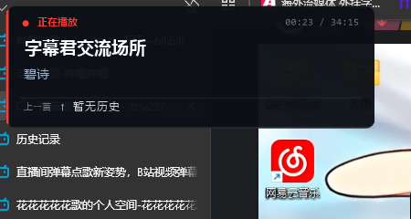

# V2 交接说明（给新会话）

> 本文是「下一次继续开发 V2」的上下文快照。读完这一篇即可接手，不需要翻历史对话。

## 0. 一句话现状

**V1 已发布（v1.1.0），V2 完成了两件事：点歌指令解析 + 队列核心（S1）、BV 点播播放链路（S4）。**
剩下 S2（弹幕接入）、S3（多平台取流）、S5（展示整合）。

## 1. 仓库与构建

| 项 | 值 |
|---|---|
| 仓库 | https://github.com/EonloveL/D-music_toppin |
| 分支 | `main` |
| 最新提交 | `9497289` feat(v2): BV 点播链路打通 |
| 构建 | `powershell -ExecutionPolicy Bypass -File .\build.ps1`（**不需要 .NET SDK**，首次自动下载 55 MB 工具链到 `.cache\nuget`） |
| 产物 | `build\MusicToppin-Setup.exe`（当前 348 KB）、`build\app\` |
| 运行 | 安装后从托盘启动；调试可直接跑 `build\app\MusicToppin.exe` |

**重要**：项目是 `.NET Framework 4.8` + 直接调 Roslyn `csc`（**不是** `dotnet build`，虽然仓库里有 `MusicToppin.csproj`，那是历史遗留，不要用它构建）。

## 2. V2 已完成的部分

### S1 点歌解析 + 队列（纯逻辑，有测试）

| 文件 | 职责 |
|---|---|
| `src/MusicToppin/SongRequest.cs` | `点歌/點歌` 解析：`wy` / `qq` / `am` 前缀、`id:123`、`BV 号`、`b23.tv` 短链、繁体；必须「点歌 + 空格」开头 |
| `src/MusicToppin/RequestQueue.cs` | 队列：去重、用户冷却、歌曲冷却、上限、FIFO、顶歌、按人撤回、冷却清理 |
| `.cache/request-tests.cs` | 27 项单元测试（编译命令见 `.cache/compile-tests.ps1`），当前 **27/27 通过** |

### S4 BV 点播（已验证可播）

```
BV 号 → api.bilibili.com/x/web-interface/view（cid/标题/时长，实测无需 cookie）
      → api.bilibili.com/x/player/playurl?fnval=16（DASH，AAC）
      → 挑最高码率 audio.baseUrl（带 backupUrl）
      → 隐藏的 WebView2 <audio>，通过 WebResourceRequested 注入 Referer
      → 正常播放，状态回传给 HUD
```



| 文件 | 职责 |
|---|---|
| `src/MusicToppin/Bilibili.cs` | BV 解析、view + playurl、多码率选择、`ResolvedSong` |
| `src/MusicToppin/WebView2Player.cs` | 隐藏 WebView2 宿主（屏幕外 2×2 窗口）、Referer 注入、播放/停止/seek、500 ms 状态轮询、备用地址重试 |
| `src/MusicToppin/PromptDialog.cs` | 通用单行输入框（输入 BV 号用） |
| `src/MusicToppin/NowPlayingService.cs` | 新增 `SetOwnPlayback(np)`：点歌播放时自有状态压过 SMTC/窗口通道 |

托盘菜单已加：**「点歌测试（播放 BV）…」**、**「停止播放」**。

## 3. 关键决策与代价

| 决策 | 原因 | 代价 |
|---|---|---|
| 播放用 **WebView2** 而不是 mpv/ffmpeg | Chromium 原生支持 B 站 DASH(fMP4)，且能注入 Referer 绕过热链；mpv 要多 30–70 MB | 安装包 85.5 KB → **348 KB**；播放时有 3 个 `msedgewebview2` 进程，合计约 **180 MB** 内存 |
| **双模式**：纯显示 / 点歌 | 保住 V1「96 KB / 26 MB」的卖点 | 需要判断何时初始化 WebView2（目前是首次播放时才创建） |
| 播放引擎独立于 HUD | HUD 只认 `NowPlaying` 状态 | 需要维护 `SetOwnPlayback` 的进入/退出 |

## 4. 待办（建议顺序）

### S2 弹幕接入（需要测试直播间号）

- B站直播 WebSocket：`wss://broadcastlv.chat.bilibili.com/sub`
- 流程：`room_init` 拿真实房间号 → 鉴权包（`uid=0` 游客可用）→ 30 s 心跳 → 解 zlib/brotli 包 → 取 `DANMU_MSG`
- 解析出的弹幕文本交给 `SongRequestParser.TryParse`，成功则 `RequestQueue.Enqueue`
- 建议新增：`DanmakuClient.cs`，事件 `Action<DanmakuMessage>`；托盘加「连接直播间」设置项
- 注意：游客身份拿不到完整用户信息，`RequesterUid` 可以先填 0

### S3 多平台取流

- 网易云：搜索 + 取流需要 weapi/eapi 加密（参考项目 `BxNcm-DJ` 有实现可对照重写）
- QQ / Apple Music：非官方接口，风险更高，建议做成可开关的独立 resolver
- 接口建议：`interface ISongResolver { Task<ResolvedSong> ResolveAsync(SongRequest req); }`，每个平台一个实现，失败只影响单个源

### S5 展示整合

- HUD 增加「队列预览」（下一首/排队）——`NowPlaying` 已有 `PrevTitles/PrevArtists` 模式可参考，建议加 `NextTitle/NextArtist/QueueCount`
- 点歌成功/失败给一路弹幕提示（需要 S2 的发送能力或至少托盘气泡）

## 5. 已知坑（别再踩）

1. **安装器会删文件**：现在只清理 `*_MusicToppin.exe` 残留。加新依赖 DLL 时不要假设会被保留，确认 payload 里有。
2. **WebView2 必须在可见窗口里**：宿主窗口是屏幕外 2×2（`-32000,-32000`），不能用隐藏窗口，否则不渲染/不出声。
3. **B 站音频直链有热链保护**：所有 CDN 请求必须带 `Referer: https://www.bilibili.com`，否则 403。备用地址（`backupUrl`）要自动重试。
4. **playurl 目前不需要 wbi 签名**（2026-11 实测），但 B 站随时可能改；如果突然返回 `-403`，先怀疑这一点，需要实现 wbi（md5 签名 + nav 接口拿 mixin key）。
5. **csc 编译要带 `/nowarn:8632`**，且所有 `.cs` 里中文字符串用 UTF-8；`toolchain.ps1` 已处理。
6. **`git` 是便携版**：`D:\tools\MinGit\cmd\git.exe`（没进 PATH）。提交前先 `cd D:\music_toppin`。
7. **中文日志乱码**：`%TEMP%\musictoppin.log` 是 UTF-8，PowerShell 5.1 直接 `Get-Content` 会乱码，用 `-Encoding UTF8`。

## 6. 调试入口

```
MusicToppin.exe --demo            演示数据（不读系统播放）
MusicToppin.exe --demo-fast       演示数据，12 秒切一首
MusicToppin.exe --play-bv=BV1xx411c7mD   启动即播放指定 BV（自动化验证用）
```

- 日志：`%TEMP%\musictoppin.log`
- 设置：`HKCU\Software\MusicToppin`（`Hotkey`、`UpdateUrl`、`WizardShown` 等）
- 安装目录：默认 `%LocalAppData%\Programs\MusicToppin`，可自定义

## 7. 新会话建议的第一次动作

1. `git pull`（确保拿到 `9497289`）
2. 跑一遍 `build.ps1` + `.cache\compile-tests.ps1` 确认环境
3. 从 **S2 弹幕接入**开始：先写一个能连上房间并打印弹幕的最小客户端（不改 UI），确认协议通了再接队列
